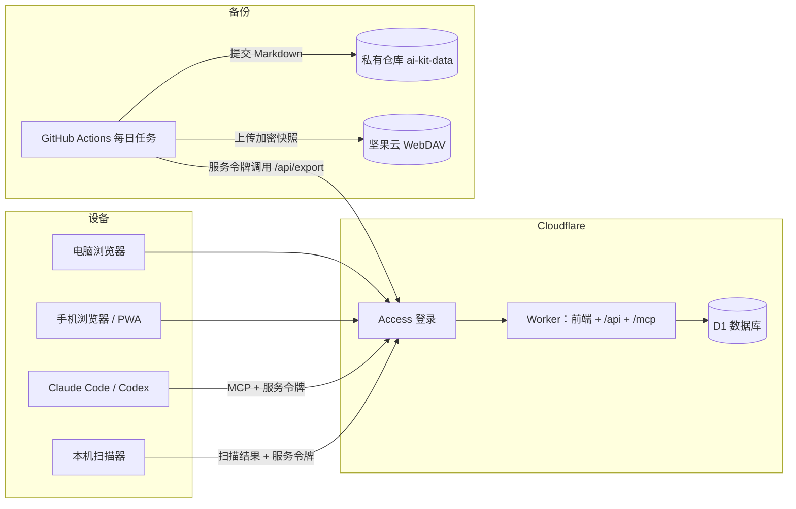

# AI 工作台：总体设计

把自己在用的 AI 工具、提示词、Skill、MCP、Hook、插件和配置整理成一份私人档案：电脑和手机上都能查，能一键复制，能随手补充；AI 代理也能读取它，并按规则帮忙整理。

- 可交互原型：[`../prototype/`](../prototype/)，双击 `index.html` 打开。
- 详细设计和开发任务：见 [文档索引](README.md)。本文只讲目标、取舍和全局结构，细节以详细设计为准。

## 1. 要解决的问题

- 配置散落在 `~/.claude`、`~/.codex`、项目里的 `.mcp.json`、聊天记录和收藏夹里。
- 换电脑或重装时，想不起装过什么，也想不起安装命令。
- 看到好用的 MCP 或 Skill 来不及整理，过几天就忘了。
- 同一个提示词改了很多版，找不到最新的那一版。

| 核心场景 | 在哪用 | 要多快 |
| --- | --- | --- |
| 找到一条提示词或命令并复制，提示词先填好变量 | 电脑、手机 | 10 秒内 |
| 看到新工具，先记下名字或链接 | 主要在手机 | 10 秒内，不要求填字段 |
| 定期整理：补全待整理的条目，标记状态并写下原因；也可以让 AI 先提出整理建议 | 电脑 | 每周一次 |
| 把一台机器现有的配置收进档案，之后定期发现新增、变化和缺失 | 每台电脑或服务器 | 一条命令 |
| 装新机器：按环境生成安装清单，照着装 | 电脑 | 一次生成 |
| 回看：某条规则为什么改，上个版本是什么 | 电脑 | 偶尔 |

**不做：** 多人协作、公开分享、保存密钥、改写本机配置文件。

## 2. 设计原则

1. **数据可迁移。** 每个条目都能导出成带 YAML 头的 Markdown（`<类型>/<标识>.md`），离开这个工具也能读，AI 也能直接读。
2. **不存密钥。** 只记环境变量名，值留在本机或密码管理器里；所有写入都做密钥扫描。
3. **先记后整。** 记录这一步越短越好，字段以后再补。
4. **AI 提建议，你来确认。** AI 和扫描器的修改以提案形式出现，接受后才写入；每次写入都有修订，可以恢复。
5. **默认私有。** 整个站点都要登录。
6. **优先免运维。** 能用托管服务就不自己维护服务器；自己的服务器只做增强，不放唯一一份数据。

## 3. 现有资源的分工

| 资源 | 角色 | 具体做什么 |
| --- | --- | --- |
| Cloudflare + 域名 | 入口、托管、登录 | 一个 Worker 托管前端、接口和 MCP；D1 存数据；Access 负责登录。子域名部署时再定 |
| GitHub | 代码、数据历史、自动化 | 私有仓库 `ai-kit` 放代码；私有仓库 `ai-kit-data` 放每日导出的 Markdown；Actions 负责检查、部署和备份 |
| 坚果云 | 异地备份 | 每天一份加密的 JSON 快照，与 Cloudflare 和 GitHub 都无关 |
| Oracle 2C2G（Always Free） | 可选增强 | 作为档案里的一个环境，并在上面运行扫描器；方案 B 的冷备；可选的常驻定时任务 |

Oracle 不当主力的原因：Always Free 实例在 7 天内满足闲置条件（其中之一是 CPU 利用率的 95 分位低于 20%）就可能被回收；单台机器还要自己打补丁、做备份。放在主链路之外，它出问题时档案照常可用。

国内访问：`*.workers.dev` 在国内经常打不开，必须绑定自己的域名；Cloudflare 免费版在国内速度一般，前端把数据缓存在本地后，日常查看基本不受影响。

## 4. 方案选择

| | A. Cloudflare 全托管（采用） | B. Oracle 自托管 | C. 纯 Git + 静态站 |
| --- | --- | --- | --- |
| 组成 | Worker（静态资源 + API + MCP）+ D1 + Access | Docker：Node + SQLite，cloudflared 隧道 + Access | Markdown 仓库 + 静态站 + Access |
| 运维 | 几乎为零 | 系统、容器、磁盘、备份都要自己管 | 几乎为零 |
| 在线编辑与手机记录 | 好 | 好 | 差，要去 GitHub 或 Obsidian 里改 |
| 主要风险 | 平台额度或政策变化 | 实例被回收、单点故障 | 编辑太麻烦，最后不用了 |

采用 A：不用维护服务器，登录、HTTPS、数据库都是现成的；数据每天镜像到 GitHub 和坚果云，需要时可以迁走。后端用 Hono + Drizzle 编写，同一套代码能改用 Node + SQLite 运行，给 B 留了退路。

## 5. 总体架构

- 人通过 Access 登录；程序（AI 代理、扫描器、备份任务、手机快捷指令）各用一个服务令牌，只拿到完成任务所需的最小权限。
- 前端把全部数据缓存在浏览器的 IndexedDB 里：打开即显示，断网也能查，联网后自动同步。
- 扫描器在每台机器本地运行，负责**收集**本机配置；MCP 让 AI **使用**档案并提出整理建议。两者的分工见 [07](detailed/07-mcp-scanner.md#两者分别做什么)。

## 6. 信息架构

- **条目**：档案里的每条记录，分为工具、提示词、Skill、MCP、Hook、插件、配置、模型与 API 八种内置类型，可以在设置里增加类型。
- **片段**：条目里可一键复制的命令、配置或提示词，可标记为安装命令；提示词里的 `{{变量}}` 复制前填写。
- **状态**：待整理、想试、试用中、在用、已弃用。
- **环境**：一台机器或一个使用场景用到的条目集合，由你自己新建、改名和删除；每个条目在环境里可以写备注（如版本、路径的差异）。环境页能生成安装清单。
- **提案**：AI 或扫描器提出的改动，在“待确认”页接受或拒绝。

字段和约束见 [02-data-model](detailed/02-data-model.md)。

## 7. 路线图

| 阶段 | 内容 | 任务 |
| --- | --- | --- |
| 0 原型（当前） | 用原型试用五种结构和三套配色，录入真实条目，调整字段 | — |
| 1 MVP | 数据与接口、登录、同步与离线、全部页面（五种结构、三套配色）、PWA、部署、每日备份 | WP0–WP10（含 WP7A–WP7D） |
| 2 完善 | 历史版本界面、字典与标签管理、手机快捷指令与 Android 分享 | WP11–WP13 |
| 3 接入 AI | 提案与待确认页、MCP 端点、本机扫描器 | WP14–WP16 |

每个任务的产出和验收标准见 [09-tasks](detailed/09-tasks.md)。界面提供五种结构和三套配色，用户可以随时切换，见 [08-ui-spec](detailed/08-ui-spec.md#界面结构)。
